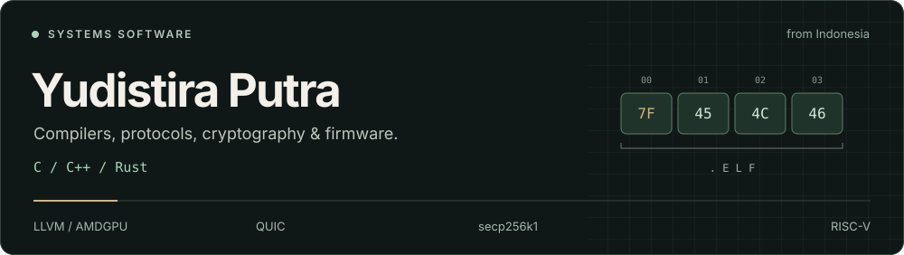
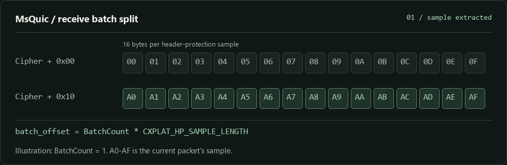

<picture>
  <source media="(max-width: 600px)" srcset="assets/systems-stack-mobile.svg">
  
</picture>

I am an OpenSats grantee and systems programmer based in Indonesia, working primarily in C, C++, and Rust on Bitcoin Core, libsecp256k1, zero-knowledge virtual machines, compilers, and security-critical firmware.

I focus on correctness at the byte, register, and algebraic level: where boundary arithmetic overflows, where elliptic curve additions hit degenerate points at infinity, and which regression harness kills subtle mutants. I also build tools for inspecting binary structures, formal limb bounds, and replaying edge failures.

[Email](mailto:pyudistira519@gmail.com) · [LinkedIn](https://www.linkedin.com/in/yudistira-putra-dev/) · [PR history](https://github.com/pulls?q=is%3Apr+author%3AYudis-bit)

---

### Work that landed upstream

| Project | What I changed |
| :--- | :--- |
| **[LLVM / AMDGPU](https://github.com/llvm/llvm-project/pull/210583)** | Prevented image-load merges that lose TFE/LWE status results. Added MIR regression tests for the affected ordering. |
| **[Microsoft / MsQuic](https://github.com/microsoft/msquic/pull/6320)** | Fixed reversed source and destination arguments when copying a header-protection sample after a receive batch splits. |
| **[Trezor Firmware](https://github.com/trezor/trezor-firmware/pull/8056)** | Cleaned up IPC message queues on task termination to prevent dangling queue handles and stale message leaks across tasks. |
| **[Consensys / gnark-crypto](https://github.com/Consensys-Incorporated/gnark-crypto/pull/923)** | Returned `ErrZeroNbDigests` on empty digest slices in batch KZG opening and verification, avoiding division-by-zero panics. |
| **[Vulkan Validation Layers](https://github.com/KhronosGroup/Vulkan-ValidationLayers/pull/12743)** | Added a bounds check to stop descriptor validation reading past a smaller pipeline-layout binding. |
| **[Bitcoin Core / secp256k1](https://github.com/bitcoin-core/secp256k1/pull/1893)** | Added constant-time test coverage for `schnorrsig_sign_custom`, including custom nonce callbacks. |
| **[OpenSBI](https://github.com/riscv-software-src/opensbi/commit/f95648d3955d72f77e13315a990a6135303978a5)** | Bounded SBI extension-list writes to the caller's buffer. Added a redzone regression test. |
| **[Google / Kafel](https://github.com/google/kafel/pull/46)** | Corrected the m68k `mseal` argument name from `size` to `flags`. A small fix to the syscall policy definitions. |

### One patch, at byte level

When a MsQuic receive batch splits, the current packet's header-protection sample needs to move to offset zero for the next batch. The copy had its source and destination reversed. This is the buffer change behind [the fix](https://github.com/microsoft/msquic/pull/6320):

<picture>
  <source media="(prefers-reduced-motion: reduce)" srcset="assets/sample-copy.png">
  <source media="(max-width: 600px)" srcset="assets/sample-copy-mobile.gif">
  
</picture>

Illustrative byte values; each sample is 16 bytes. <a href="assets/sample-copy.png">Still frame</a> · <a href="tools/render-copy-demo.py">Animation source</a>

<strong>A few more details behind the patches</strong>

- **AMDGPU:** TFE/LWE image loads return an extra status word. The merge path didn't preserve it, and checking only the first instruction missed the ordinary-load to status-load ordering. The fix excludes these instructions while collecting merge candidates.
- **Trezor Firmware:** When a task is killed, pending message queues retained dangling pointers to dead task contexts. The fix drains and de-registers the IPC channel on task exit.
- **gnark-crypto:** KZG multi-proof verifiers dividing by polynomial degree panicked when given zero digests. The check returns a structured error before evaluating quotient commitments.
- **OpenSBI:** Advancing a buffer offset by a name's nominal length could make the remaining capacity negative, then turn it into a large unsigned size for `sbi_snprintf`. The fix stops appending before the next name exceeds capacity; the test checks a redzone beyond a 16-byte buffer.
- **secp256k1:** Functional signing tests and constant-time tests exercise different properties. The added CHECKMEM coverage reaches the custom signing entry point and nonce callback with secret-key material marked undefined, so Valgrind can catch its use in branches or memory addresses.

### On my desk

Active work spans cryptographic batching, zkVM curve invariants, consensus script interpretation, and transport protocol state machines.

<strong>Active patches and review threads</strong>

 

| Project | Patch |
| :--- | :--- |
| **secp256k1** | [BIP-352 silent payments sender output batching](https://github.com/bitcoin-core/secp256k1/pull/1970) hoisting `e*A` and using Montgomery batch inversion; [4x64 scalar reduction optimization](https://github.com/bitcoin-core/secp256k1/pull/1954) eliminating `c2` via 128-bit accumulators; [MuSig2 scratch space allocation](https://github.com/bitcoin-core/secp256k1/pull/1971) in `pubkey_agg`; [CTest constant-time test runners](https://github.com/bitcoin-core/secp256k1/pull/1944). |
| **SP1 (Succinct)** | [Weierstrass affine addition coordinate invariants](https://github.com/succinctlabs/sp1/pull/3013) preventing branch collapse on identity points; [ed25519 dalek off-curve fallback parity](https://github.com/succinctlabs/sp1/pull/3014) in zkVM precompiles. |
| **arkworks** | [Extended Jacobian bucket affine recovery](https://github.com/arkworks-rs/algebra/pull/1183) during multi-scalar multiplication. |
| **c-kzg-4844** | [PeerDAS EIP-7594 vanishing polynomial evaluation](https://github.com/ethereum/c-kzg-4844/pull/674) using 128-point subgroup roots symmetry; [precomputed Miller loop lines](https://github.com/ethereum/c-kzg-4844/pull/673) for constant G2 pairing points. |
| **Bitcoin Core** | [Script interpreter mutant tests](https://github.com/bitcoin/bitcoin/pull/36360) killing 12 mutants in `script.cpp`; [x-only key comparison](https://github.com/bitcoin/bitcoin/pull/36420) in Tapscript Miniscript duplicate checks. |
| **MsQuic** | [Validate `RETIRE_CONNECTION_ID` sequences and packet CID](https://github.com/microsoft/msquic/pull/6325), with frame receive regression tests. |
| **OpenSBI** | [Bound RPMI shared-memory queue names and terminate strings](https://github.com/riscv-software-src/opensbi/pull/423). |
| **Google / nsjail** | [Fail closed when mount flags or final remount fail](https://github.com/google/nsjail/pull/344). |
| **Google / Kafel** | [Align m68k and i386 syscall argument names](https://github.com/google/kafel/pull/47) for portable policy definitions. |

Status as of October 2026. Links point directly to upstream review threads.

### Things I'm building

| Project | What it's for |
| :--- | :--- |
| **[Bitpeek](https://github.com/Yudis-bit/bitpeek)** | Inspect bytes, file structures, endianness, limb schedules, and binary diffs. Runs in the browser, CLI, and as a local MCP server. [Try it](https://bitpeek-seven.vercel.app). |
| **[ecc-audit-engine](https://github.com/Yudis-bit/ecc-audit-engine)** | Compare secp256k1 implementations against reference mathematical models, synthesize limb bounds, and replay failing edge seeds. |
| **[why-ui](https://github.com/Yudis-bit/why-ui)** | Let coding agents inspect actual browser behavior: find what covers a button, trace it to local source, and verify fixes live. |

I also maintain a [routing simulation](https://github.com/Yudis-bit/Cognitive-Routing-Protocol) comparing a bandit-based router with Dijkstra across multiple seeds to track delivery rates alongside latency.
